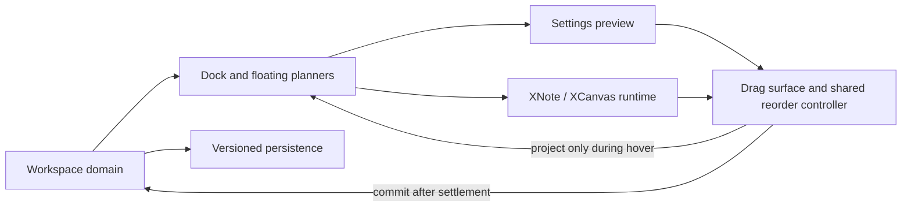

# PR #431 — reviewer package

**Status:** draft; emulator coverage and release build do not replace physical Redmi Pad 2 stylus verification.

## Scope and examples

The implementation introduces multiple configurable toolbars for **XNote and XCanvas**. A workspace may contain docked and/or floating bars at four edges with Start / Center / End alignment, from one to three item rows, plus independently scrollable center regions and optional fixed Start/End items.

| Example | Initial layout | Action | Expected result | Review evidence |
| --- | --- | --- | --- | --- |
| 1 — occupied upper edge | Vertical **RIGHT · START** tools + compact colors at RIGHT/CENTER | Long-press Colors, drag past RIGHT/START, release at **TOP · CENTER** | Colors reflow horizontally; right tools stay visible; no jump after releasing | `ToolbarOccupiedTopCenterComposeTest.hoverThroughRightStartOneRowFloatingTopCenter` (and docked variant) |
| 2 — multiple neighbors | A TOP/RIGHT bar, a RIGHT/START bar, and a 1–3-line moving bar | Move to TOP/CENTER | Occupied lanes project their new locations while dragging, then remain stable on commit | `ToolbarOccupiedTopCenterComposeTest` — 3-bar cases |
| 2b — return to occupied right edge | Colors at TOP/CENTER, another toolbar at RIGHT/START | Drag Colors to RIGHT/CENTER, release and observe the next half-second | The bar stays inside the right edge while its narrow content reflows inside its animated lane | `ToolbarOccupiedTopCenterComposeTest.video1610*` — four frame-sampled cases |
| 3 — cross-edge morphology | Two-row docked bar at LEFT | Long-press and release near BOTTOM | Same bar ID, upright icons and intermediate reflow; no stretching of a toolbar bitmap | `ToolbarLivePlacementComposeTest` and `ToolbarContainerMorphComposeTest` |
| 4 — toolbar reordering | Two bars sharing an edge/lane | Hold and drag one past its peer | One reordered visual order, no duplicate bar or stranded indicator | `ToolbarLivePlacementComposeTest` and `ToolbarTitleAndPreviewReorderComposeTest` |
| 5 — pinned regions | Start/Center/End content on a toolbar | Resize it below the visible content length | Start/End stay visible when present, center scrolls, absent regions consume no space | `ToolbarBarsBalancedComposeTest`, `ToolbarEmptyRegionComposeTest` |
| 6 — workspace persistence | Distinct XNote and XCanvas layouts | Save, leave and reopen the editor | Original context/layout is restored; no geometry is persisted in raw pixels | Workspace JSON, migration and template unit tests |

**Important boundary:** The automated screens exercise actual Compose components but **are not filmed Xiaomi stylus demonstrations**. Do not use those tests as a substitute for the final hardware clip.

## Video capture package for the PR description

Record on Redmi Pad 2, landscape, with an empty test note (no private handwritten material). Suggested three clips:

1. **`pr431_01_overview.mp4`** (20–30 s): open XNote toolbar settings; create a second bar; show the compact inspector, live preview and switch to XCanvas.
2. **`pr431_02_occupied_edges.mp4`** (25–40 s): keep one 2–3-row vertical bar at **RIGHT · START**, another at **TOP · RIGHT**; drag a one-row Colors bar to **TOP · CENTER** slowly, passing the occupied region, then release. Repeat in docked mode; hold the final position onscreen for two seconds to expose any flicker.
3. **`pr431_03_reorder_regions.mp4`** (25–40 s): move two differently sized bars onto the same edge; reorder them; show Start/End pinned and Center scrollable; close/reopen to demonstrate persistence.

Keep the pointer/touch indicator visible. Capture movement **before, during and after** the release; do not cut away at the completion frame. These are demonstration instructions, not claims that the actual recordings already exist. Upload recordings as GitHub user attachments to PR #431, or to a release, then insert the actual URLs here and in the PR body. Do not invent placeholders that look like real links.

## Review order (dependency stack)

| Stage | Draft PR | Change boundary |
| --- | --- | --- |
| Model | [fork #4](https://github.com/wesleydanieell/xnotes-android/pull/4) | Immutable workspace geometry and docking |
| Persistence | [fork #5](https://github.com/wesleydanieell/xnotes-android/pull/5) | Backward-compatible storage, templates and migration |
| Runtime | [fork #6](https://github.com/wesleydanieell/xnotes-android/pull/6) | Shared renderer for XNote/XCanvas |
| Editor | [fork #7](https://github.com/wesleydanieell/xnotes-android/pull/7) | Workspace editor, add/duplicate/edit |
| Layout | [fork #8](https://github.com/wesleydanieell/xnotes-android/pull/8) | Multiple dock lanes, safe sizing, pinned regions |
| Preview and drag | [fork #9](https://github.com/wesleydanieell/xnotes-android/pull/9) | Optimistic preview, gestures, live handoff and UI |

Each draft compares to its **immediate predecessor**. [Upstream #431](https://github.com/shardulvs/xnotes-android/pull/431) is the integration draft, not an additional independent change that needs reviewing from scratch.

## Architecture after cleanup

- `core/tools`: immutable geometry, collision-free dock planner, visual order and toolbar model, independent of Compose.
- `settings`: JSON, templates, legacy migration and editor preference ownership.
- `ToolbarDragGeometry.kt`: pure root-space viewport and settle-offset calculations. Never use an old child inset as the destination origin when the toolbar rotates.
- `ToolbarDragSurface.kt`: pointer/long-press detector, same-gesture hover, 220-ms settlement, parent acknowledgement and cancellation recovery.
- `ToolbarWorkspaceReorderController.kt`: optimistic hit-testing and reorder/placement transaction; input rectangles captured at drag start.
- `WorkspaceFloatingBars.kt` and `ToolbarFrame.kt` (`ToolbarAround`): runtime composition, cached base/proposed layout plans and peer positions.
- `ToolbarWorkspacePreview.kt`: layout plan/interaction, ghost and candidate slot; `ToolbarPreviewBar.kt` renders sections and controls separately.
- `ToolbarContainerMorph.kt`: shared item-level interpolation without icon rotation or bitmap scaling.

## Validation gate

- Frame assertions check both the moving bar and its peer before/after acknowledgement, plus presence of the destination indicator. Exercise single-, double- and triple-line bars and compact, regular and large sizes.
- **113/113 Compose tests passed** on `Small_Tablet`, in four instrumented batches (live 34, preview 38, occupied placement 26, layout 15), after the geometry/Compose refactor and RIGHT/START return regression.
- `ToolbarOccupiedTopCenterComposeTest` has cases with an occupied **RIGHT · START** edge and a TOP/CENTER drop via intermediate hover. Before the fix, two of four multi-step cases failed with a one-frame 24-pixel x displacement. All four pass after the parent-slot settlement correction.
- On the Redmi screen recording from 2026-11-14 16:10, TOP/CENTER → RIGHT/CENTER briefly pushed the color bar beyond the viewport and recovered a few frames later. A frame-sampled runtime reproduction found that right-edge content alignment moved a narrow child inside an independently growing parent lane, while a fixed projected-root compensation remained applied. `ToolbarLiveReorderBar` now computes the *current* aligned child origin using the parent width/height animation; `ToolbarDragSurface` subtracts that dynamic origin until the final position is acknowledged. Four new reverse-edge cases verify the bar and rendered body stay within viewport bounds. Hardware revalidation remains pending.
- Full JVM: **2671/2671 tests**, with en_US locale to stabilize an unrelated decimal-format snapshot; release build and lint-vital passed. Review APK installed on Redmi Pad 2 at 16:29 on 2026-11-14. Visual stylus re-check remains necessary.
- **Release blocking:** physical Redmi Pad 2 stylus QA, screen recording covering the late release frame, and maintainer feedback on stacked PR ordering.
